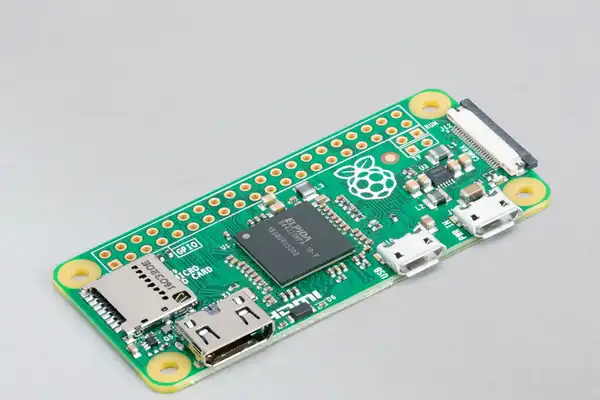
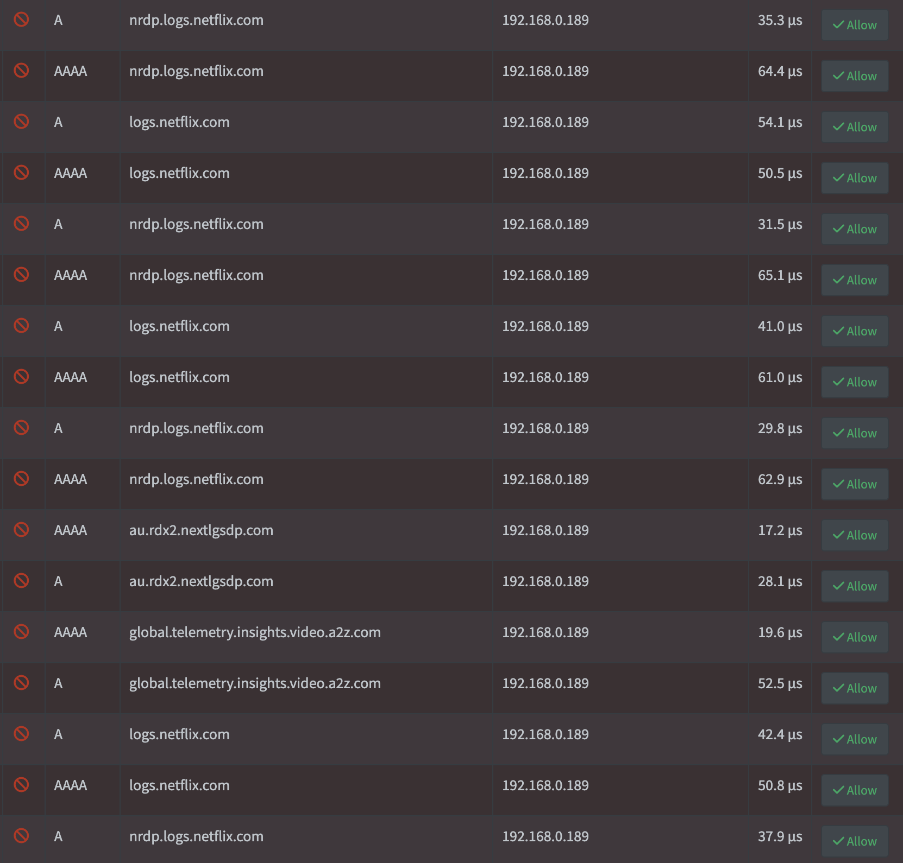
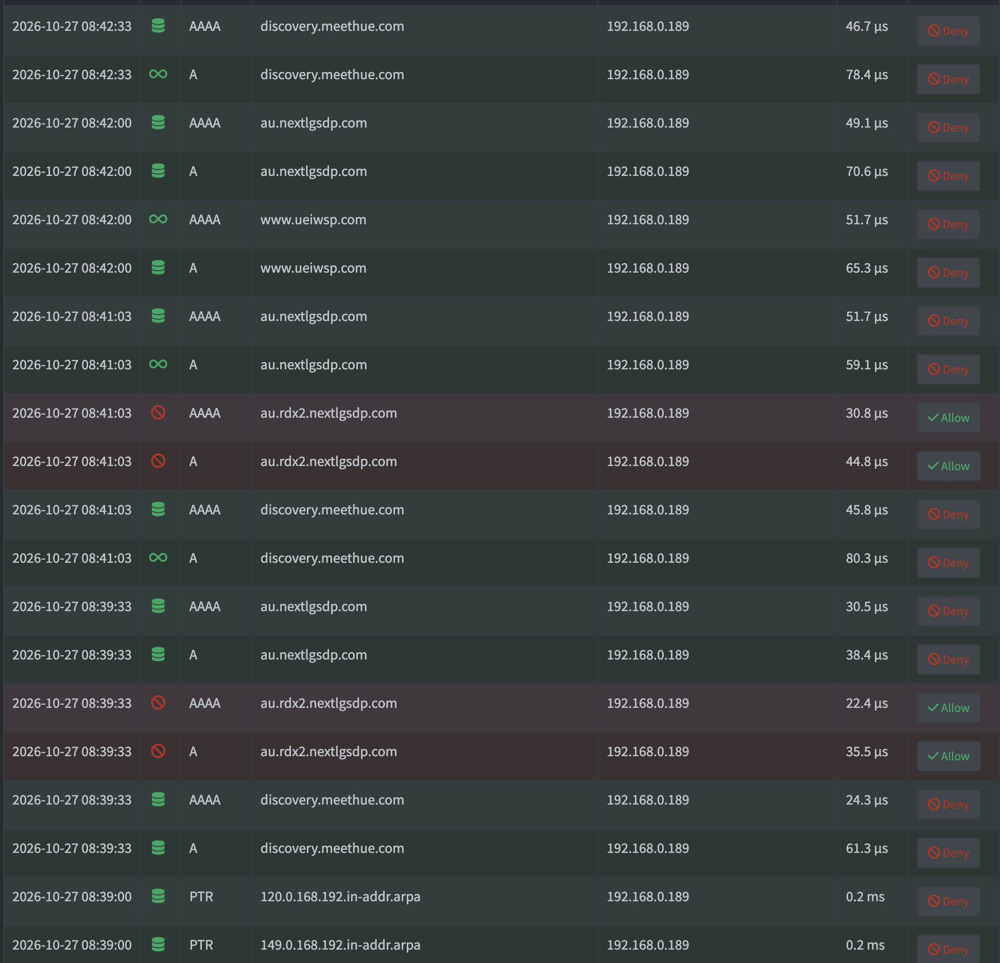

News has broken that smart TVs are tracking you. LG, though I presume other brands are also doing similar, has been found to [track users when the TV is off](https://arstechnica.com/gadgets/2026/09/lg-tv-shown-capable-of-tracking-user-activity-even-when-offline/) and people are now wondering if [your TV is spying on you](https://au.pcmag.com/tvs/119111/is-your-tv-spying-on-you-hidden-setting-watching-everything-how-to-stop).

I have an LG TV, along with some networking skillz, so I thought I'd take a look and see what I could find out.

## Set up a DNS monitor
If you want to set up the tools to monitor your TV, get yourself a handy Raspberry Pi. Here is a Raspberry Pi Zero:

Some models come with WiFi, but for this networking purpose I'd suggest using a wired connection. If you stick with WiFi, the latency will probably affect your performance.

Once it's up and running, install Pi-hole. It lets you monitor traffic and block traffic you don't want. You'll find the setup guide here: [https://docs.pi-hole.net/](https://docs.pi-hole.net/).
Do add an extra blocking list for TVs, e.g. [this list for LG TVs](https://raw.githubusercontent.com/hagezi/dns-blocklists/main/adblock/native.lgwebos.txt).

## Configure your home router to use the DNS monitor
You will want all of the devices in your home to use Pi-hole, and to do that you can update your home router's DNS settings.

Log in to your home router and:

1. Work out the IP address of the Raspberry Pi
2. (optional) Update the router so that the Raspberry Pi gets a "static address" or a "reserved address". This will ensure that the address given to it will not change
3. Update the DHCP settings so that the "primary DNS" is set to the Raspberry Pi

## See what is going on
You may need to restart the TV for it to get the new DNS setting, but once done you should start seeing logs appear in Pi-hole.

In my case, over the course of a minute, I could see the following:

Every 4 seconds Netflix tries to log something. WTF?! What makes this especially grating to me is that I stopped being a Netflix subscriber 6+ months ago!
Otherwise, there are about 4 other log entries over the space of a minute for LG telemetry / tracking.

I deleted the Netflix app (naturally), waited a bit and the logs looked as follows:

The TV is just on the Home Dashboard. Again, why the constant traffic? At least it's following a similar pattern. "discovery.meethue.com"? "au.nextlgsdp.com"? I'll have a quick look and then probably hit the Deny button to block those addresses.

I also left it overnight and found that the TV didn't send anything to LG.

It's not great, but it's not the terrible flood that the news suggested.

So why is my TV not as bad as the news was making out?

## It's all about the EULAs
My TV has been "bugging" me since I bought it to accept 6 End User Legal Agreements:

* Terms of Use
* Privacy Policy
* Viewing Information Agreement
* Voice Information
* Interest-Based Advertisement Agreement
* Marketing Communications Agreement

I only ever accepted the first two. This seems to be the key and it aligns with a press release from LG. They spy on you if [you agree to it](https://gizmodo.com/lg-denies-its-tvs-are-spying-on-you-unless-you-opted-in-2000810968).

Naturally, my preference would be that companies wouldn't do this, or that governments would have laws in place to stop it from happening, but until then you can opt out of the EULAs.

For LG TVs, go to All Settings -> Support -> Privacy -> User Agreements and uncheck all except the first two. For more useful tips, I found [this guide](https://www.pocket-lint.com/i-stopped-my-lg-tv-from-spying-on-me-by-adjusting-these-settings/) to be the most helpful.
