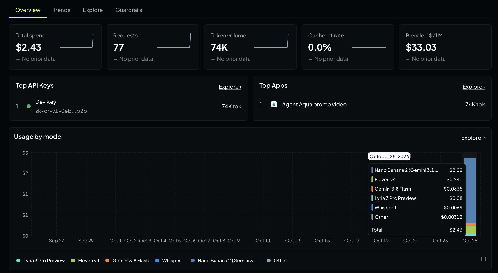

Every so often, I make a new app. It's always a monumental effort but at the end I'm usually happy with the result. The build phase is enjoyable. It's why I got into Software Engineering. However, it's what comes after that is the problem... Marketing. I can write the code, but marketing? That's a dark art.

So, three months ago I felt that it was time for my next app. It has been a fun build phase and the result at the end is... [Agent Aqua](https://agentaqua.net/)! The app solves a problem I have with gardening. Some parts of my garden die off due to not being watered enough and some parts do poorly due to being over-watered. I wanted something to take the guesswork out of the equation. I wanted something that I could use to take pictures of my plants, have it work out what the plants need on a daily basis and tell me if the plants need watering today or not. The app even has a built-in superpower: it can talk to my taps and do the watering for me. Naturally, as the creator, I think the app is awesome :)

Now though, I'm at that dreaded stage: Marketing.

I'll do the basics: SEO & ASO. I reckon though I'm gonna need something else to help stand out from the crowd. Something impactful. Perhaps some videos? I'll want something which draws attention and pops. Can AI help?

## Prep
If you want to follow along yourself at home, you will need to do some prep:

1. Have a Claude Pro or above subscription. For this particular task, with my Claude Pro subscription I used Opus on High Effort
2. Create an OpenRouter account. Claude is great, but there are AI models in OpenRouter which are specifically there to make audio and video. Claude will be more than happy to leverage their capabilities
    1. Buy $10 of credit in OpenRouter
    2. Create an API Key and save it to a `.env` file in the root of your repo with the contents: `OPENROUTER_API_KEY=key_goes_here`

## Promo video
Firstly, we need a video to describe what the app does. I used the following prompt:

> Create a 60 second hand drawn collage animation with audio for https://agentaqua.net/ .
>
> I want this video to be high quality. Don't shortcut it. The future of my app depends on it. I want the video to tell people all about https://agentaqua.net/ and after seeing the video they will want to download the app and use it to manage their garden watering schedule.
>
> To help you along, I have an OpenRouter API Key in the .env file. I have a budget of $10. Do work out which model to use and make sure the output is top quality.
>
> I'll need you to plan the video and implement it. It will take time and I won't be around to answer questions so do make best efforts to get it done.
>
> In addition to a version for a website, do make a short clip for the socials
>
> Best of luck!

...and it made the video! It took about 45 minutes, ended up using half a dozen different models including Whisper and Nano Banana, and cost $2.43.

Check out the result!

<video controls playsinline preload="metadata" width="1920" height="1080" poster="/assets/images/poster-agent-aqua-film.jpg" src="https://media.agentaqua.net/film/agent-aqua-film-v1.mp4">
  <a href="https://media.agentaqua.net/film/agent-aqua-film-v1.mp4">Watch the Agent Aqua film</a>
</video>

## Want something more realistic?
...just use a different opening paragraph for the above prompt:

> I need a 30s-60s real-life style advertisement with appropriate audio for https://agentaqua.net/ .

<video controls playsinline preload="metadata" width="1920" height="1080" poster="/assets/images/poster-agent-aqua-ad-real.jpg" src="https://media.agentaqua.net/film/agent-aqua-ad-real.mp4">
  <a href="https://media.agentaqua.net/film/agent-aqua-ad-real.mp4">Watch the realistic Agent Aqua ad</a>
</video>

## Targeting a particular market segment? Don't like the 'golden hour' AI video effect?
You've probably noticed that AIs seem to love making their videos more brown/orange/gold in colour. Rumour has it that they learned this by training on too many Instagram photos taken during [the golden hour](https://en.wikipedia.org/wiki/Golden_hour_(photography)). Not a fan of the colour scheme?

Also, what if you want to make a promo video for a particular market segment?

As an example, let's go with French-speaking retired Parisian artists :) Just replace the first paragraph of the above prompt with something similar to the following:

> I need a 30s-60s real-life style advertisement, in the French language, with appropriate audio for https://agentaqua.net/ . It should be set in Paris and feature a retired Parisian artist who lives in an apartment near the Eiffel Tower. Try to avoid the "golden hour" colour scheme that I see in many AI videos.

...and boom!

<video controls playsinline preload="metadata" width="1920" height="1080" poster="/assets/images/poster-agent-aqua-paris.jpg" src="https://media.agentaqua.net/film/agent-aqua-pub-paris-60s-16x9.mp4">
  <a href="https://media.agentaqua.net/film/agent-aqua-pub-paris-60s-16x9.mp4">Watch the Agent Aqua Paris ad</a>
</video>

> **Aside:** This video cost a mere $0.93. My bad, I forgot to top up OpenRouter and Claude had an impossible task of making the video with just $0.97 in the OpenRouter account. It found a free stock video and adapted that. Clever Claude :)

## Conclusion
With a small budget, you could keep doing this all day!
Do give it a go! See what you can make for your product. If you want another example, check out my next post: [making the next #1 hit song](/2026/11/01/hit-song-for-app/)
