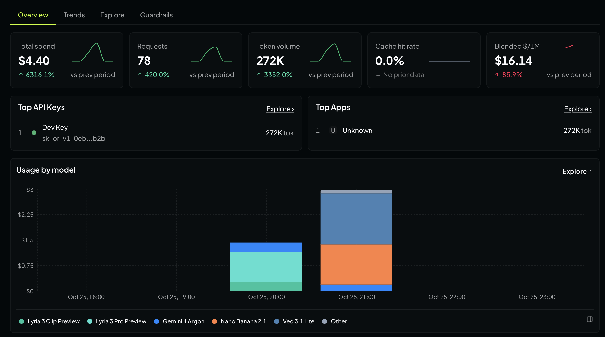

In the [previous post](), I described my latest app [Agent Aqua](https://agentaqua.net/) and how I felt that some captivating videos were needed for Marketing. With Claude & OpenRouter's help, we made some promo videos.

They are nice relaxing, descriptive videos, but I wanted more. I wanted something that could cut through in the TikToks and YouTubes of the world. It was time for... the world's next #1 hit!

## Prep
As before, if you want to follow along yourself at home, you will need to do some prep:

1. Have a Claude Pro or above subscription. For this particular task, with my Claude Pro subscription I used Opus on High Effort
2. Create an OpenRouter account. Claude is great, but there are AI models in OpenRouter which are specifically there to make audio and video. Claude will be more than happy to leverage their capabilities
    1. Buy $10 of credit in OpenRouter
    2. Create an API Key and save it to a `.env` file in the root of your repo with the contents: `OPENROUTER_API_KEY=key_goes_here`

## Generating the video
I used the following prompt:

> Create a promo song in the style of Flo Rida or Pitbull. I want an upbeat, high energy song with fun lyrics for https://agentaqua.net/ .
>
> I want this song to be high quality. Don't shortcut it. The future of my app depends on it. I want the song to tell people all about https://agentaqua.net/ and after hearing the song they will want to download the app and use it to manage their garden watering schedule.
>
> To help you along, I have an OpenRouter API Key in the .env file. I have a budget of $10. Do work out which model to use and make sure the output is top quality.
>
> I'll need you to plan the song and implement it. It will take time and I won't be around to answer questions so do make best efforts to get it done.
>
> In addition to a version for a website, do make a short clip for the socials

This was way more intense for Claude. It took over an hour, cost $4.40 and Claude leveraged the following models:

* Lyria 3: wrote and sang the song itself
* Gemini 4: judged each take. Claude set it up as a demanding record-label executive and mix engineer, to help pick the best take
* Nano Banana: drawings used in the video
* Veo 3.1: turned some of the Nano Banana stills into videos to be added to the main video

What was also interesting is that as I was watching Claude build the video, it kept running into `[PROHIBITED]` feedback from Gemini. Google wasn't entirely happy with whatever Claude was doing.

Here also is part of Claude's thought process. Glad it wasn't me figuring this out!

> The stems aren't clean enough to rebuild the mix, so I'll instead blend a touch of extra vocal into the original and trim the instrumental's 1.5–4.5 kHz band to minimize artifacts. Since the verses sit 6–8 dB under the beat and the outro call-to-action is buried by 10 dB, I'll apply a time-varying vocal lift—about +2 dB overall, with extra boosts on those sections.

## Result
Check out the result! A-qua! A-qua!

<video controls playsinline preload="metadata" width="1920" height="1080" poster="/assets/images/poster-agent-aqua-song.jpg" src="https://media.agentaqua.net/film/agent-aqua-water-or-skip-v1-1080p-r2.mp4">
  <a href="https://media.agentaqua.net/film/agent-aqua-water-or-skip-v1-1080p-r2.mp4">Watch the Agent Aqua music video</a>
</video>
